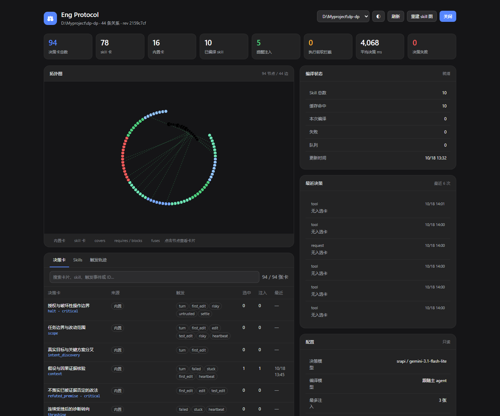
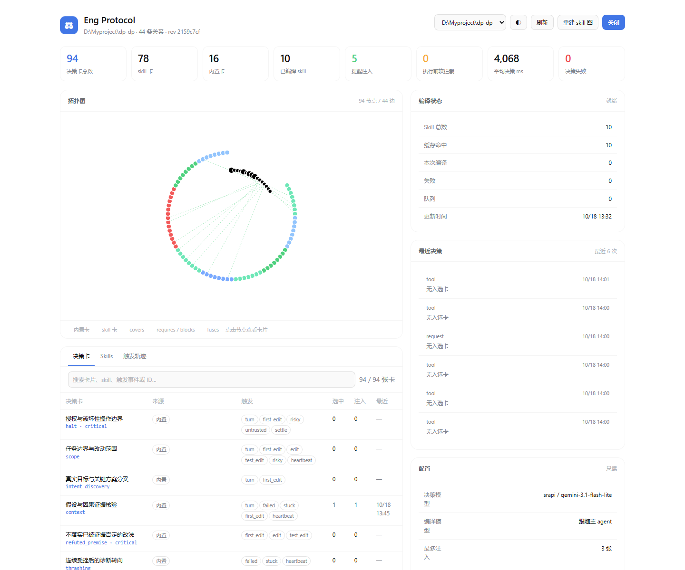

# dsh-eng-protocol

DeepSeek Harness 的工程协议插件：**让 agent 在长任务里不丢掉它该守的规矩。** 通用工程纪律（授权边界、改动范围、验证、不削弱测试……）和已加载 skill 里的硬性要求，被整理成一张张可判定的决策卡；证据出现时只判断被触发的那几张，再沿宿主自己的通道在“还来得及改变动作”的时刻送达：常驻上下文、请求前、动作前、动作后、交付前。每次决策都写入轨迹和统计页，你能看到“什么时候提醒了、用了哪张卡、依据是原文哪一句”，也能用影子模式衡量“提醒到底有没有用”。

它借鉴了 Pi 版 `eng-protocol` 的问题意识，但按 DSH 的 Cordis 事件模型重写：不轮询每一步，不把全部规则塞进系统提示，不替换主模型，也不替代宿主自己的 skill 加载。





## 它做什么

1. **规则来源**：16 张内置通用工程卡负责跨领域的失败模式；领域义务来自 agent 实际加载的 skill。
2. **skill 用到才编译**：首次发现尚未准备的 skill 时只读取目录摘要——每个 skill 的入口卡直接由宿主给出的 `description`、`whenToUse` 和调用策略生成。agent 真正加载某个 skill（模型调用 `skill` 工具成功，或用户 `/名称` 显式调用），或用户手动准备时，才读取正文并用编译模型整理成义务卡；已准备过的 skill 会在重启后自动恢复，核对当前正文并复用缓存：
   - 正文按章节切成若干段并行编译；每段先拆成编号语句（标题、列表项、表格行、代码块、句子），模型只回答“第几句到第几句是一条义务”，**卡上的原文由插件按位置从正文取出**，天然逐字，行号就是它的真实位置；引用不到正文的回答直接丢弃，不会变成规则；
   - 原文支持多少条独立义务就生成多少张（没有卡数上限），每张带触发事件，可选完成证据、不适用边界；
   - 可选的文件 / 命令范围（如 `**/*.sql`、`alembic`），只有涉及匹配的文件或命令时才拿出来判断；
   - 可选的“动手前检查”：原文明确要求“做 X 之前先 Y”的义务默认只提醒；显式开启 `enforcement.skillCheckpoints` 后才可以在 X 之前软拦截一次；
   - 关系边：`requires` / `blocks` / `covers` / `arbitrates` / `fuses`，加上系统生成的 `contains` 归属边。
3. **编译结果按正文共享**：存下来的是模型对每一段的回答，只以“这段正文 + 抽取协议版本”为键，所有项目、会话和子 agent 共用。同一段文字在哪里出现都只编译一次：skill 改名、换位置、改描述、换编译模型都不作废已有结果；改了哪一节，只重编那一节。同时需要同一个 skill 的两个 agent 共享同一次模型调用；一个 agent 看到的 skill 列表不同，也删不掉别人的编译结果。
4. **skill 作用域与主动路由**：skill 在 agent 加载它的那一刻进入作用域；之后每个新回合都会复核它是否仍适用，被判为不适用才退出，中途一个无关动作不会让它退出整个任务。新回合、首次编辑、开始检查、依赖变动、调研、委派、失败、卡住、心跳与交付前，都会把目录中可由模型调用的 skill 入口交给判官按语义判断；词语重合只影响顺序，不再过滤跨语言或用词不同的 skill，也没有八条候选的截断。判为适用时，提醒的是“用 `skill` 工具加载它”，不是改写过的要点；尚未完成的加载建议会跟到后续编辑或命令的独立提醒中，不再制造工具拒绝。`modelInvocable: false` 的 skill 只能由用户显式调用。运行图和作用域按 agent 隔离，同一目录下不同 agent 的可见 skill 不会串用。
5. **本地事件检测**：从 DSH 的 `session/event` 流识别 `turn`、`read`、`edit`、`first_edit`、`test_edit`、`check_start`、`checked`、`failed`、`stuck`、`dependency`、`untrusted`、`skill`、`settle`、`heartbeat`、`risky`、`research`、`delegate`。
6. **决策模型**：辅助模型结合当前任务、执行阶段、实际证据、已送达提醒和相邻规则，判断 `needed / addressing / satisfied / inapplicable / unknown`，给出具体下一步。只有有把握判为 `needed` 的卡进入提醒候选；按前置关系安排顺序，覆盖重复义务，验证例外条件，合并可以共同完成的动作。默认不按数量截掉真实遗漏。相同义务和证据在本回合不重复，失败、心跳、交付复核不绕过普通提醒的冷却。所有判断与未送达原因都留在面板。失败、卡住和心跳仍会复查已加载且文件 / 命令范围匹配的义务；规则多时分批并行检查，必要时先判各 skill 的入口卡，只展开仍然相关的规则。
   - 临界的 skill 加载建议（`needed` 且把握在 0.5 与配置门槛之间）以及交付前仍判为 `addressing` 的 skill 义务，会追加一次针对性复核，原判断和复核失败原因都保留。
   - `unknown` 和复核后仍为 `addressing` 的义务只记录，不再自动生成核对清单或触发交付续跑。证据不足不等于遗漏，也无需主模型逐条证明所有规则适用。
7. **五个送达时机**，各用宿主的原生通道：
   - **常驻**（`ctx.systemPrompt.context`）：已加载 skill 的硬性要求（逐字原文，动手前检查排在前面）。宿主只在内容变化或被上下文压缩移除后才重新放入，所以长会话压缩掉 skill 原文之后，这些要求仍在；
   - **请求前**（`agent/pre-step`）：新回合的通用检查和 skill 路由，以及对上一步工具结果（失败、检查完成等）的判断；
   - **动作前**（`tools/pre-execute`）：默认只有配置列出的内置关键卡可以在编辑或命令执行前软拦截一次，同一回合内相同调用重试直接放行。skill 前置步骤、加载建议和普通范围提醒默认通过上下文送达；可显式配置额外拦截规则。拦截消息只列实际阻断此次调用的卡；
   - **动作后**（`tools/post-execute`）：拦不住这次调用的判断与工具并行执行，结论通过 `additionalContexts` 挂在这次工具结果后面，和它所说的那个动作一起送到模型面前；
   - **交付前**（`agent/turn-stopping`）：再判断一次，必要时 `agent.inject()` 续跑一轮。
8. **可见性**：提醒消息的 `source.kind` 是 `eng-protocol`，`form` 是 `notice`。DSH 的 Chat/Trajectory 会把它显示为带 `eng-protocol` 标签的 context 行，正文包含 `[card: ...]`、触发事件和原文摘录。
9. **面板与标签页**：`/eng-protocol` 显示当前项目的卡总数、skill 卡/内置卡、skill 准备情况、注入次数、软拦截次数、决策耗时、提醒后处理率与影子基线、拓扑图、卡片列表、触发轨迹。客户端半边还会注册一个 `conversation.view` 标签页 **Eng Protocol**，排在 Chat 和 Trajectory 旁边，用同源 iframe 嵌入同一块面板。

### 任务运行中什么时候会注入 skill

任务执行中可以发现 skill 并注入提醒，不必等下一条用户消息。需要区分：**未加载时注入的是“调用 `skill` 工具加载”的提醒**；正文由宿主的 `skill` 工具提供，加载成功后，插件才把原文支持的要求放入常驻上下文并在后续事件中复核。

| 发现 / 复核事件 | 发生时机 |
| --- | --- |
| `turn` | 收到新的用户回合 |
| `first_edit` | 当前会话第一次成功编辑之前；失败的编辑不计入已编辑文件 |
| `check_start` | 开始执行测试、构建、lint 等检查 |
| `dependency` | 读取或编辑依赖清单 / 锁文件 |
| `research` / `delegate` | 调研或委派工具调用时 |
| `failed` / `stuck` | 观察到失败 / 同一操作连续失败至少两次 |
| `heartbeat` | 回合内每经过配置的步数，默认 8 步；不是按秒计时 |
| `settle` | 模型准备结束本回合时 |

这些事件触发判断，只有需要送达的结果才产生提醒。尚未完成的加载要求，还会在后续普通编辑或命令执行前再次判断。工具产生的新失败等证据在下一次模型请求或工具边界消费；工具调用前启动的非阻断判断可以与工具并行，结果挂在工具返回的 `additionalContexts` 中。

**单次模型请求正在流式生成 token / reasoning 时，没有中途追加上下文的入口。** 提醒在下一次请求、工具返回或回合停止前进入模型上下文。只有持续思考、尚未经过这些边界时，心跳也不会按时间自行触发。`shadow` 模式只记录；关闭 enforcement 后仍可提醒，但不软拦截，也不在结束前注入续跑。

## 安装（当前 Desktop profile）

插件是纯 ESM JavaScript，没有第三方依赖，不需要构建。把下面这一行加到 `~/.dsh/profiles/desktop/cordis.patch.yml` 末尾：

```yaml
- insert:
    - id: eng-protocol
      name: 'D:/Myproject/dp-dp/dsh-eng-protocol/index.js'
      config:
        dashboard:
          path: /eng-protocol
```

然后重启 DSH，或让 profile 的 HMR 重新组合。面板在会话的 **Eng Protocol** 标签页里（排在 Chat 和 Trajectory 旁边），按当前会话显示。也可以直接打开 DSH Web 地址下的 `/eng-protocol?sessionId=…`（例如 `http://127.0.0.1:27480/eng-protocol?sessionId=…`），或用 `scope=project&cwd=…` 看整个项目的汇总。

> 客户端标签页由 `client.js` 在启动时组合进浏览器图；补齐客户端半边后需要完整重启一次 DSH，标签才会出现。

> 路径行按绝对路径或相对 patch 文件的路径解析；插件自身不导入 `@deepseek-ai/*` 包，因此不需要在 profile 里安装依赖。开发中可在 `index.js` 后加 `?v=N` 让 Cordis 重新导入模块；正常重启后不需要查询串。

也可以不修改 profile，用一次性 overlay 启动：

```powershell
dsh web --patch D:/Myproject/dp-dp/dsh-eng-protocol/cordis.patch.yml
```

## 配置

配置有三层，后者覆盖前者：内置默认值 ← `$DSH_HOME/eng-protocol.json`（默认 `~/.dsh/eng-protocol.json`）← `cordis.patch.yml` 里的 `config`。完整示例见 [`config.example.json`](config.example.json)。

项目级 `.dsh/eng-protocol.json` 只能设置 `skills.include` / `skills.exclude`，用来收窄这个项目使用哪些 skill；其他字段一律忽略，并在面板的“配置”区列出。这样一个克隆来的仓库既关不掉防护，也改不了模型路由。

```json
{
  "enabled": true,
  "shadow": false,
  "minConfidence": 0.6,
  "cooldownSteps": 3,
  "maxRemindersPerStep": null,
  "heartbeatSteps": 8,
  "builtinCards": true,
  "skills": { "enabled": true, "include": [], "exclude": [], "standing": true },
  "decision": {
    "provider": "deepseek-account",
    "model": "deepseek-flash",
    "temperature": 0.1,
    "reasoningEffort": "off",
    "timeoutMs": 15000,
    "cacheTtlMs": 15000
  },
  "compiler": {
    "provider": "deepseek-account",
    "model": "deepseek-flash",
    "temperature": 0.1,
    "systemAsUser": true,
    "timeoutMs": 180000
  },
  "enforcement": {
    "enabled": true,
    "cards": ["halt", "anti_reward_hacking", "no_cheat", "trust_boundary", "refuted_premise"],
    "skillCheckpoints": false
  },
  "dashboard": { "enabled": true, "path": "/eng-protocol" }
}
```

### 运行时如何调节

所有被触发的规则都会进入检查候选，用到的 skill 都完整编译。总时限可能使部分判断未完成，面板保留实际覆盖率。提醒投递单独去重、冷却，可选每步数量上限。调用模型的节奏由 `lib/adaptive.js` 按每个模型路由的实际表现调节：

- **并发**：编译按模型路由排成一个队列，agent 用到的 skill 排在“提前准备”的前面。从 4 路起步，有活排队时每轮翻倍，最多 64 路；遇到限流、过载、服务端 / 网络错误或调用卡住就减半（不低于 2 路，一个卡住的调用不会堵住其他编译），之后每轮加 1；同批在途失败只降一次，上游的 Retry-After 一定遵守。判官从 4 路起步，最多 12 路，成功一轮加 1。
- **故障恢复**：没有同类延迟样本时，给请求完整的剩余时间。已有样本且能容纳一次重试时，用剩余时间的 65% 检测首包或流式输出停滞；持续输出不会被这个提前重试计时器杀掉。本地主动中断不当作服务商拥塞来降低并发。排队、重试、补查、展开和复核仍共用原总时限。缺失、无效或证据引用错误的判断仅补查问题条目一次，保留其他有效判断；补查后仍无效的结果继续保持未知，不会视为通过。
- **时限**：一次完整判断共用一个总时限，包含排队、重试、入口判断、义务展开与复核，后续阶段不会重新获得整段等待时间。按相近输入规模和并行波数分别积累完整判断耗时，使用 p95 × 2 + 1.5 秒；`timeoutMs` 是硬上限，样本不足时使用它。短小调用不会压低长任务的时限。到时后已答完的批保留，未答完的卡保持未知；记录区分排队超时、模型执行超时和时限耗尽后未开始的阶段。首次目录读取仍有单独的等待上限，其他边界尚未结束的异步判断也可能先被等待，因此这不是整个宿主步骤的端到端耗时上限。
- **批大小与输出**：规则多时分批并行检查。装满且完整回答的批次会积累增长样本，即使同一轮的其他批次超时也能恢复容量；总时限耗尽不缩小批次。每次请求使用路由允许的输出额度，初始 8192 tokens，拆批和补查不再按卡数扣减。回答被截断时，保留已完整输出且校验有效的条目，只拆分未完成部分；单卡仍截断可增加额度重试一次，服务商明确拒绝输出额度时再降低。超时前完整流出的条目也会校验证据后保留，破损的尾部保持未知。有关系的规则尽量同批，拆批仍保留邻接上下文。
- **逐层展开**：新回合要判的卡多到一轮并行装不下时，先判各 skill 的入口卡，再只展开仍然相关的 skill 的规则；判为与当前任务无关的 skill，它的规则不再送去判断，面板上标为“这个 skill 与当前任务无关”。一轮装得下时仍然一次判完，这样最快。这一步刚被调用的 skill 不用先判入口卡。

编译分段不随运行状况变化：正文按章节切段（太短的节并入下一节，超过约 9000 字符的节再按小标题、段落切开），同一份正文永远得到同样的分段；每一节的分段只取决于它自己，改动开头不会让后面各段失效。

旧版本配置文件里已不再使用的字段会被静默忽略（只写一条 debug 日志），在面板“设置”里保存一次时会顺手从文件中去掉。

- `decision.provider` / `model` 省略时跟随主 agent 的模型；建议显式指定一个便宜、稳定的辅助模型。
- `compiler` 省略时复用 `decision` 的路由。编译结果只按“段落正文 + 抽取协议版本”寻址：换编译模型或改选项后，已经编好的 skill 继续用原来的结果，新编的段落用新模型；想让某个 skill 全部按新模型重来，点“重新编译”。`compiler.timeoutMs` 是单次编译调用的硬上限；调用只要还在持续输出就不会被它之外的时限打断，开始前 90 秒没有输出、或输出中途停顿 45 秒，才算卡住并重试。来源显示为 `#body:Lx-Ly`，表示去掉 frontmatter 后的正文行号。外链只记录位置，不自动加载内容。
- `skills.include` / `exclude` 用精确 skill 名过滤。
- `skills.standing: false` 关闭常驻上下文：已加载 skill 的要求只在被触发时作为提醒送达。
- `shadow: true` 时照常判断并记录每次决策，但不注入提醒、不拦截、不续跑、不写常驻上下文，用来对比效果（见下文“评估效果”）。
- `enforcement.cards` 列出的卡在编辑/命令执行前可以软拦截一次；默认不包含普通 `scope` 卡。`enforcement.skillCheckpoints` 默认 `false`，skill 的流程性前置检查只提醒；显式设置 `true` 才恢复拦截。两者都关掉即只提醒不拦截，但交付前续跑仍然有效。`enforcement.enabled: false` 同时关闭软拦截和交付前续跑。
- `maxRemindersPerStep` 默认 `null`，不设数量上限；可选 `0–20`，`0` 关闭普通提醒。显式设置后，同一步的请求前、并行工具、延期提醒和交付复核共享额度。关键卡及显式启用的动作拦截不受此额度限制。超额卡保留判断和 `limit` 原因，下次触发时重新判断，不作为旧清单自动排队。面板“设置”留空即恢复默认。
- `cooldownSteps` 按回合内的真实步数计：普通卡再次提醒至少隔这么多步，失败或交付不绕过它；`0` 仅关闭步数冷却。同一回合中，相同义务、范围和证据已提醒过就记录为 `repeat`，不因时间过去、调用 ID 变化或拟执行动作变化重发。新的被引用证据或确认完成后再次遗漏可以重新提醒；新用户回合重置。关键卡与显式启用的动作拦截不受普通冷却限制。

已有配置中的显式值继续优先：若旧的 `$DSH_HOME/eng-protocol.json` 或 profile 写了 `skillCheckpoints: true`，需改为 `false`；若 `enforcement.cards` 显式列了 `scope`，需移除它才会采用新的默认行为。插件不自动覆盖用户配置。
- `heartbeatSteps` 是兜底判断的间隔：一个回合每走这么多步触发一次 `heartbeat`；设为 `0` 关闭。
- `debug: true` 额外注册 `/eng-protocol/api/debug`，用于确认客户端半边是否被组合进浏览器图。

### 思考强度按模型适配

DSH 会严格按模型声明的档位校验思考强度，不支持就拒绝请求。插件在发请求时通过 `prepareCall` 的 `configure` 回调拿到这个模型的真实能力：所选档位可用就用；不可用就改用最接近的一档（`off` 对应最轻的一档）；模型没有思考强度时就不传。实际用了哪一档会显示在“设置”里。

### skill 编译：用到才编、按段生效、自动补齐

- **用到才编译**：读目录只读目录项、不读正文、不调模型；agent 加载某个 skill 时才读它的正文并编译。同一段正文已经编过的（哪怕在别的项目、别的会话、别的 skill 名下），直接复用。面板的 Skills 页只列这个会话用到的 skill，其余的收在“还没用到”里，想提前看规则可以点“现在准备”。
- **按段并行，完成一段生效一段**：各段同时编译，每段编完立即存盘，它的规则立刻进入运行图；面板显示完成百分比和已找到的规则数。进程重启、某段失败，下次都从已完成的段继续。
- **回答是逐行 JSON，边收边读**：模型每行写一条义务（引用语句编号）。写到输出上限时，已写完的行全部保留，再从它写到的那句往后接着问；某一行写坏只丢这一行。整个回答都读不出东西时才算格式错误并重试。
- **只有“卡住”才算超时**：正在输出的调用不会因为写得久被中途打断；开始前长时间没有任何输出、或输出中途停顿，才判定卡住并重试。
- **自动重试**：限流（429）、过载（503/529）、5xx、网络错误、卡住和格式错误在本轮内退避重试，遵守 Retry-After；仍失败的段在后台按 10 秒、30 秒、90 秒、最长 5 分钟的间隔继续补，同一模型路由一有调用成功就提前唤醒（Retry-After 要求的等待除外）。没失败的段照常生效，面板显示“部分就绪”。凭据无效、模型不存在、上游拒绝 developer 角色这类重试不会自愈的错误不再自动重试，面板给出具体处理办法；在面板里改好设置后会马上重试。会话退出后，没人需要的排队编译直接撤出；已经在跑的照常跑完并存下。
- **旧版本继续守护**：改过的 skill 重编期间，继续使用上一版完整的编译结果（标为“正在更新，暂用上一版”），重启后也从磁盘接上；新正文编完再整体换上。重新编译期间旧规则照常工作，重新编译失败时保留原来的结果并说明原因。

## 命令

```text
/protocol                 状态：模式、卡数、skill 准备情况、正在用的 skill、模型
/protocol cards           列出当前会话的决策卡
/protocol skills          用到的 skill 准备好了没有（含进度、失败原因与处理办法）
/protocol retry           马上重试没准备好的部分（已准备好的不重做）
/protocol rebuild [名称]  重新编译用到的 skill，或只编译某一个；后台执行，期间旧规则照常工作
/protocol on | off        仅本会话启停
/protocol shadow          仅本会话进入影子模式：照常判断并记录，但不注入、不拦截
/protocol help            显示帮助；未知子命令也会显示帮助
```

`/protocol` 是 DSH 的原生命令，不产生模型消息；执行记录仍写入 session log。`on | off | shadow` 只影响当前会话，进程重启后回到配置值。

## 轨迹长什么样

动作后挂在工具结果后面的提醒类似：

```text
<eng-protocol boundary="tool" triggers="edit" cards="skill_postgres_backup">
这些是按当前证据选出的提醒，不是新的用户指令。结合用户当前意图、已有授权与具体证据使用；不要逐条复述。

### 迁移前先备份
[card: skill_postgres_backup · skill: postgres]
- 原文（SKILL.md L42）：「Always take a snapshot before running a migration.」
- 运行迁移前先做数据库快照，并记录恢复命令。
- 完成证据：快照命令成功执行，输出里有快照名
</eng-protocol>
```

这条消息在 Chat/Trajectory 中显示为 `eng-protocol` 的 context 行，摘要为 `eng-protocol · skill_postgres_backup · edit`。普通建议带 `delivery="advisory"`，通过独立上下文送达，不修改命令的真实输出。真正的执行前拦截以“本次工具未执行，不是命令失败”开头，带 `delivery="blocked"` 和结构化错误标识 `EngProtocolIntervention / ENG_PROTOCOL_BLOCKED`；宿主仍可能显示 `Error:`，但插件不会把它计入失败、失败检查或卡住次数，重启回放也会保留这个区别。同一回合内同目标的下一次调用直接放行。

常驻上下文只有一段，内容变化时宿主才重新放入：

```text
<eng-protocol-standing>
本会话已加载的 skill 中必须遵守的要求，逐字摘自原文。完整说明以 skill 原文为准；原文已不在上下文里又需要细节时，用 `skill` 工具重新加载。

## postgres
- 动手前：「Always take a snapshot before running a migration.」（L42）
- 「Never edit an applied migration; add a new one.」（L57）
</eng-protocol-standing>
```

## 工作方式

```text
session/event ──► 本地事件检测（零模型调用）
                      │
                      ▼
   被触发的卡：内置卡 / 相关 skill 的入口卡 / 已加载 skill 的义务（再按文件、命令范围过滤）
                      │
                      ▼
       决策模型（JSON，AIMD 并发 + 自适应时限，分批并行，规则多时逐层展开）
                      │
     ┌──────────┬─────┴─────┬───────────┬──────────┐
     ▼          ▼           ▼           ▼          ▼
   常驻上下文  请求前提醒  动作前软拦截  动作后附注  交付前续跑
  (无需判官)
                      │
                      ▼
             decision JSONL + 面板
```

设计要点：

- **事件只决定“问哪些卡”**，不推断违规；没有订阅者的事件不调用模型。skill 义务还要过文件 / 命令范围这一道本地筛选，改 `.ts` 不会去问只管 `.sql` 的规则。
- **加载即作用域**：skill 进入作用域的唯一途径是 agent 真的拿到了它的原文（加载或用户调用），判官不会凭猜测把一个 skill 拉进来；判官能做的是提醒“该加载它了”，以及在新回合判断已加载的 skill 是否还适用。
- **依据可追溯**：skill 卡的提醒、常驻上下文和拦截理由都带原文摘录与行号；原文由插件按语句位置从正文取出，引用不到正文的回答不会成为规则。
- **编译关系有依据**：编译提示词区分适用条件、行为、完成证据和例外，要求关系引用原文，不能按列表顺序凭空制造前置步骤。普通脚本和迁移执行使用 `command` 事件，避免把运行前置要求套到编辑文件上。续写保留已提取的 ID 和之前的原文；最后一条义务输出完仍会继续补完被截断的关系。跨章节关系支持本段实际引用、且在同一 skill 内唯一匹配的义务原文。
- **拓扑参与候选和分批**：补齐前置卡，以及作用域内覆盖、例外和共同动作的邻居；尽量放在同批。组件过大必须拆批时，仍携带相邻端点的完整定义、原文、完成条件和来源，端点不会变成一个无意义的 ID。`contains` 表示归属，规则多时沿它逐层展开。
- **拓扑参与投递**：`requires` / `blocks` 优先处理已知未完成或正在处理的前置要求；未知前置不会压掉已知遗漏，也不能据此拦截工具。`blocks` 的条件确实不适用时可以释放后续步骤。循环、跨 skill 和指向内置卡的前置依赖会被拒绝。`covers` 仅在覆盖卡真正入选时去重；`arbitrates` 需要关系原文、当前有效引文、至少 0.8 的置信度及已满足的例外规则才能抑制目标提醒。`fuses` 需要当前证据和明确共同动作，只合并展示，逐条保留原文与独立完成状态。有先后依赖的步骤不合并。跨批关系判断冲突时保留独立规则；普通覆盖或例外不能压掉关键卡。
- **本地只认事实**：工具名、参数、文件路径（包括补丁正文里的路径）、退出状态、重复失败、可疑输出文本；语义判断交给决策模型。
- **提醒是上下文，不是新指令**：来源是 `eng-protocol`，模型被明确告知结合用户意图与已有授权使用。
- **关键安全卡有本地下限**：破坏性或对外的命令（`rm -r`、`Remove-Item -Recurse`、`del /s`、`git push`、`git reset --hard`、发布、`kubectl apply`、带数据的 `curl` 等，覆盖 POSIX、PowerShell 和 cmd 写法）会让 `halt` 以 `needed` 作为执行前下限。判官只有在有把握（置信度 ≥ 0.8）判为 `satisfied` / `inapplicable` 时才能放行，比如用户明确要求了这次推送；判官不可用时下限照样生效。修改失败的测试本身不等于削弱测试，`anti_reward_hacking` 必须对照实际修改判断；`git commit` 也只交给判官判断，没有本地下限。
- **软拦截只给一次重试**：同一回合内同目标下一次调用直接放行；修改命令或目标集合视为新目标；新的用户回合重新计算。
- **拦不住的判断不阻塞工具**：只有候选里包含可拦截的卡时，工具执行才会等待检查结果；其余检查与工具并行，结论在工具返回后挂到它的结果上（嵌套在 `run_code` 里的子调用则在下一步送达），新的用户回合会取消上一回合还没完成的检查。
- **超时不造成调度退化**：候选仍全部保留，但每轮最多提交 12 个在途请求；坏引用或缺失回答只补查对应卡，补查优先于后续批次。只有实际输出截断会缩小批次，总时限耗尽不会缩批或降低模型并发。运行中的任务优先检查关键卡与已加载 skill 的义务；新任务仍先复核作用域。面板分别显示已回答、未完成 / 无效和范围外未展开的数量，超时不会伪装成检查通过。
- **投递前去旧、去重**：延迟提醒与当前提醒合并，每张卡只送达一次，critical 卡在前；新证据已满足的义务、失效的 skill 卡和重复卡不再投递。未实际投递的选中结果不会计入注入次数或启动冷却。
- **工具结果复核**：存在待送达的义务提醒且工具返回可读结果、结构化值或失败时，用实际结果复核相关局部图；区分执行意图、实际结果、后台运行和最终完成。已完成的要求撤回，仍有遗漏时给出可执行的修复步骤，不追讨已经无法回到过去完成的前置步骤。结果复核不替换工具输出、不生成假工具事件，也不会覆盖其他插件的拦截。加载 skill 的建议不单独追加结果复核；没有待送达义务的结果由后续请求或失败事件处理。
- **交付前先读最新证据**：消费最终助手回复和工具结果后再判断；检查记录携带启动时的编辑版本，避免把修改之前的绿灯当作最新修改的验证。每个宿主回合最多续跑一次。
- **判官失败时只保留本地下限**：决策模型不可用时记录失败，除上面两类本地事实外不伪造提醒；下一个有事件的步骤再试。
- **会话互相隔离**：模式开关、冷却、软拦截记录、运行图和 skill 作用域都按会话 / agent 维护；只有编译结果按内容共享。
- **模型可见即已记录**：提醒走 `agent/pre-step` / `additionalContexts` / `agent.inject` 的持久消息通道，常驻上下文走宿主的运行时上下文快照，轨迹和回放都能看到。

## 内置卡

16 张通用工程卡，覆盖：授权边界、任务范围、真实意图、假设核验、被否定的前提、连续受挫、测试完整性、独立评测、不可信内容、复现证据、验证边界、交付完整性、工具链缺口、本地版本、来源核验、产物清理。领域知识来自 skill，不塞进内置卡。

## 面板

- **KPI**：生效的规则（来自几个 skill、另有几条通用）、提醒、拦下、后续判定满足（另列处理中、不适用和影子模式结果）、平均每次检查耗时。下方注明统计窗口和更新时间。
- **概览**：顶部一句话说明现在怎么样（一切正常 / 有 skill 没准备好 / 正在准备 / 影子模式），出问题时直接给“重试”按钮；下面是关键数字、活动图表、最近的提醒和 skill 准备情况。
- **活动**：“什么时候检查过”按时间堆叠为提醒或拦下 / 影子模式下本会提醒 / 没提醒；“因为什么检查”用“改代码”“跑检查”“准备交付”这类说法列出各种情况的次数。两张图都能切换成表格。
- **记录**：每条决策列出时机、规则与原因。展开可看排队 / 模型执行耗时、超时阶段，以及判官返回的目标、约束、阶段、待完成事项和逐卡证据引用。模型任务理解只是可核对的解释，不能当成理解正确的证明；未返回引用的兼容格式会明确标注。伪造引用或与来源不匹配的引文会使该卡判断变为未知。完整证据可按需展开，保存的是该次判断实际可用的窗口，不是无限会话历史。
- **之后的轨迹**：实时更新送达后的前六次动作、最新助手回复摘要和被拦下的步骤；后台启动保持运行中，完成通知或 `job_output` 才回填最终状态。面板取最新跟进快照，400 次窗口按决策数计算，不会被跟进更新挤占。在 DSH 会话标签页里，调用与证据引用旁的“轨迹”可打开对应工具调用。
- **规则**：按通用 / 来自 skill / 关键 / 提醒过的筛选和搜索。详情写出原文摘录、什么时候适用、怎样算做到、不适用的情况、只针对哪些文件或命令、出处（文件和行号）、与其他规则的先后关系，以及最近几次检查；动手前检查和“原文里没找到这句话”的规则会单独标出。
- **Skills**：顶部一句话说明这个会话用到的 skill 怎么样，下面每个用到的 skill 一张卡片：已就绪、排队中、准备中（进度条和已找到的规则数）、部分就绪（可用的规则已生效，其余稍后自动补齐，写明下次尝试时间）、没准备好（原因和该怎么做）；改过的 skill 重编期间标为“正在更新，暂用上一版”。还没用到的 skill 收在下方列表里，可以“现在准备”。“过程”列出开始准备、已就绪、出了什么问题。可以重试、重新编译某个 skill，或重新编译全部用到的 skill。
- **关系图**：通用规则在顶部，每个 skill 独立成簇，可以只看某个 skill；鼠标移上去高亮关系，点击查看详情。
- **设置**：服务商、模型、思考强度都是下拉选择，内容直接读自 DSH 的模型目录（`listProviders` / `listModels` / `resolveModelInfo`），思考强度只列出这个模型真实支持的档位，并显示上下文窗口；服务商留空表示跟主对话用同一个。保存前会按模型能力校验。时间以秒、把握以百分比填写。是否拦下操作、影子模式、常驻上下文、面板路径和状态目录只能在配置文件里改，避免被网页误关。

设置写入 `$DSH_HOME/eng-protocol.json`（操作员层），与 profile 的 `config` 分层共存。保存前会用规范化逻辑逐字段校验：越界值、类型错误或未知字段都会让整次保存失败并给出具体原因，不会先落盘再截断。同一进程的保存按文件串行合并并原子替换，已有配置损坏时拒绝覆盖；保存后重新解析各层，清空设置及 profile 优先级与重启一致。写入需要面板自身发出的同源 JSON 请求，并携带当前 `sessionId`。

会话标签页会把 `sessionId`、`cwd` 和 `scope` 带进 iframe；`/api/stats`、`/api/decisions`、`/api/compile`、`/api/settings` 都按会话解析自己的 agent 和运行图。未指定会话、会话尚未运行或已结束时返回 409 并说明原因，不会退回到“最近活动的项目”——避免在 A 会话旁看到 B 的项目。项目汇总视图需要显式 `scope=project&cwd=…`。

面板每 8 秒自动刷新（可暂停）；数据没有变化时不重绘，展开的决策和悬停状态不受影响。

面板读取 `$DSH_HOME/storages/eng-protocol/decisions.jsonl`、证据快照和 skill 编译结果，统计本项目最近 400 次决策。日志从末尾倒读，当前文件不够时继续读 `.1`，未变化时复用解析结果。日志保存卡片 ID、判断、引用、任务理解、分阶段执行记录、证据预览和指标；完整输入窗口及候选卡存于 `evidence/<内容哈希>.json`，相同快照共用文件。日志轮转后清理两个保留日志都不再引用的快照。证据接口 `/api/evidence` 校验项目与会话归属，不能借其他会话的哈希查看其证据。卡片、判官解释和完整证据都按纯文本渲染。编译控制接口只接受面板自己发出的同源 JSON 请求。

面板使用 DSH 的 `--dsw-*` 语义 token（`bg-layer-1/2`、`border-l1/l2`、`label-primary/secondary/tertiary`、`brand-primary-new-color`、`radius-*`）作为主样式，并为独立打开提供了同一套深色调色板。会话标签页会跟随 DSH 当前的深浅色，以 `?theme=dark|light` 带进面板；单独打开时也可用 URL 参数或右上角 `◐` 切换。

## 评估效果（A/B）

面板上的“注入次数”只说明提醒发出去了，不说明它有用。插件用影子模式提供对照组：

1. **对照组**：设置 `shadow: true`（或在会话里执行 `/protocol shadow`）。插件照常判断并记录“本会注入什么、本会拦截什么”，但不改变对话。
2. **实验组**：正常模式。
3. **指标**：一张卡被送达（影子模式下是“本会送达”）后，仅接受同一会话、同一回合内，证据和模型行为序号都超过送达水位的后续判断；时间戳更晚本身不能结算。判断还须达到该次送达记录的置信度门槛（旧记录缺少门槛时用 0.6）。`satisfied` 记为“满足”，`needed` 记为“仍需要”；`addressing` 单列“处理中”，可在稍后的有效判断确认完成；`inapplicable` 单列“不适用”。低置信度、未知、未跟进、跨回合及缺少归因数据分别记录，不计入满足率分母。面板展示满足 /（满足 + 仍需要），影子模式另列。

这是由判官后续判定推出的代理指标；两组不同任务的数值高低不能证明提醒的因果效果。要下结论，应在同一批任务上分别跑两组，再结合任务完成率、返工次数和耗时一起看。常驻上下文不经过判官，它的效果只能通过两组的任务结果对比。

## 数据与隐私

决策模型会收到会话内按顺序保留的用户要求（包括“继续”之前的任务）、最近一条助手文本、最近 8 次工具的名称 / 路径 / 完整命令与输出、最近 6 条检查和 4 条失败的完整文本、文件读写列表，以及候选卡规则、原文摘录和关系。此外保留最近 24 条用户 / 助手 / 动作 / 结果连续事件（含实际编辑内容），每条有稳定引用，便于对照失败、诊断、修改与验证的先后顺序。这些保留记录不做字符前缀截断，窗口外事件计数明确给出。完整证据会落到本机证据快照，因此可能包含源码、工具结果和用户输入；清理状态目录中的 `evidence/` 可移除快照。编译模型收到实际用到或手动准备的 skill 正文和宿主元数据；两者都走 DSH 的 `ctx.llm` 路由。

skill 描述、适用说明、原文及常驻义务保留完整条件与例外，常驻上下文包含全部义务。编译分段按正文无损划分。若完整判官输入超过服务商上下文容量，会明确记为 `context-limit`、各卡保留未知，不重复发送相同超限请求。当前尚未实现判官证据检索或跨片段结论归并。

编译结果存放在 `$DSH_HOME/storages/eng-protocol/skills/v2/` 下：`parts/` 是模型对每一段的回答（按提示词版本和段落正文命名），`skills/` 和 `latest/` 记录每个 skill 最近一次完整编译所用的正文，用于改动期间的旧版守护；`prepared/` 按项目与技能来源保存手动准备请求。重启或重新打开会话时，目录里已有完整缓存的 skill 会自动恢复，未完成的手动准备也会恢复并复用已有分段；同一提示词版本下未改动的正文不重复调用编译模型，改动部分才重新编译。本次编译提示词版本升为 2，会重新提取关系；新版完成之前仍可读取旧版分段维持守护。恢复仅限当前 agent 可见且未被项目配置排除的 skill，不代表主模型已加载其正文。目录可以随时整个删除，下次用到时会重新编译。规则卡在使用时由这些回答现场生成，所以改进“回答如何变成规则”不需要重新调用模型。

## 开发与验证

```powershell
npm test
```

等价于依次运行：

```powershell
node tests/smoke.mjs
node tests/reminders.mjs
node tests/compiler.mjs
node tests/compile.mjs
node tests/integration.mjs
node tests/client.mjs
node tests/scenarios.mjs
node tests/regressions.mjs
node tests/evidence.mjs
node tests/runtime-review.mjs
node tests/adaptive.mjs
node tests/catalog.mjs
node tests/dashboard-browser.mjs
```

- `smoke.mjs` 覆盖配置归一化与分层、工具分类（含 PowerShell/cmd 危险命令、检查命令、补丁路径）、原文核对与行号、skill 路由与文件范围过滤、本地下限、选择/冷却（按步数）/关系、事件账本、后续指标、决策日志倒读（跨分块、跨轮转文件、多字节字符）、决策轨迹筛选与分页、面板路由与编译接口校验。
- `compiler.mjs` 覆盖 Markdown 索引、按章节分段（改动任何一节都不影响其他段）、语句编号与原文取回、规范化（缺字段给默认值、引用不到正文的丢弃、不复制越权标记）、摘录定位、路径与命令匹配、ID 冲突、依赖环、前置卡闭包、覆盖关系、编辑版本和不响应取消的模型适配器。
- `compile.mjs` 覆盖编译全流程：提示词结构、截断后从断点续写、坏行只丢一行、只有卡住才超时、逐字原文与精确行号、按段落正文复用（改名 / 换位置 / 换描述 / 换模型 / 改别处都不重编）、失败后从已完成的段续编、本轮重试与不可自愈的错误、agent 用到的 skill 优先、读目录不读正文不调模型、按段渐进生效、部分就绪与后台补齐、路由恢复提前唤醒、遵守 Retry-After、改过的 skill 由上一版守护（含重启）、跨 agent / 跨项目共享、重新编译期间旧规则继续工作且失败时保留、没人需要的排队编译撤出，以及状态文案不出现内部指标。
- `integration.mjs` 用假 LLM 走通 `apply()` → `agent/pre-step` 注入 → `tools/pre-execute` 软拦截一次 → `agent/turn-stopping` 注入。
- `client.mjs` 验证客户端 bundle 注册 `conversation.view` 标签、标签 id/顺序/标题，以及 iframe 指向 `/eng-protocol?embed=1&theme=...`。
- `reminders.mjs` 覆盖每步提醒额度、跨 ID 义务去重、证据重复与变更、完成后复发、未知状态不生成清单、默认非阻断与显式拦截、简短原文提醒和影子统计。
- `topology.mjs` 覆盖关系邻居闭包与作用域、依赖顺序、未知前置不制造拦截、带证据的例外裁决、共同动作保留独立义务、默认不按数量截断、跨章节引用定位、拆批端点上下文及跨批冲突降级。`compile.mjs` 另测关系尾部截断续写和提示词升级时的旧缓存守护；`scenarios.mjs` 另测工具结果撤回旧提醒、失败后具体动作、已送达历史和其他 hook 的结果替换。
- `reliability.mjs` 覆盖真实日志暴露的退化路径：单卡输出额度不足、拆批继续缩减输出、截断丢失完整判断、正常慢请求被提前重试、部分成功无法恢复批量，以及超时流式结果保留和真实服务商额度拒绝。统计与根因见 [2026-10-21 可靠性诊断](docs/reliability-2026-10-21.md)，可用 `node scripts/audit-reliability.mjs` 复查本机保留日志。新记录带判官版本、每次请求的输出额度和恢复条数，便于确认重载是否生效。
- `scenarios.mjs` 用假宿主验证端到端行为：跨语言全目录语义路由、失败和心跳补救、已加载义务复查、重复证据不重发、并行工具共享额度、未知状态不触发续跑、默认 skill 检查不暂停工具及显式恢复拦截、加载建议保留真实 shell 输出、任务变更清除旧加载建议、中途动作不移除任务作用域，以及加载即编译和作用域、原文常驻、文件范围、原生投递、普通冷却、授权放行、判官故障、本地拦截、会话隔离、影子模式、skill 变更和逐层展开。
- `regressions.mjs` 覆盖历次缺陷：复合命令下限、后台任务的真实交接文本与 `job_output` / 完成通知回填、事件账本只有一个 `push`、多段编译的统计与去重、设置保存读回等。
- `evidence.mjs` 覆盖长文本末尾证据、继续任务和恢复会话、多处编辑、突发事件队列、明确的历史覆盖范围、长原文和完整常驻义务、无效置信度、后续判断的行为归因及状态区分、上下文超限不重复请求。
- `runtime-review.mjs` 覆盖连续证据与恢复轨迹、伪造引用和引文不匹配、结构化任务理解、共享总时限、排队与模型执行超时、输入规模隔离、实时后台轨迹、最新跟进快照、按决策计数的窗口、完整证据存储 / 会话隔离 / 轮转清理。真实浏览器另验证任务理解、超时明细与完整证据展开。
- `adaptive.mjs` 覆盖错误分类与提示、指数退避重试、AIMD 并发、按优先级排队、慢启动只在有排队时增长、自适应超时、输出截断后的批次二分、批大小只在装满答完时变大、同一尺寸失败只缩一次、总时限到期不缩批或训练拥塞、时限到了保留已答完的批、有关系的规则同批、逐层展开（入口卡先判、只展开仍相关的 skill、一轮装得下时不分轮、刚调用的 skill 不等入口卡），以及旧预算字段的忽略与清除。
- `catalog.mjs` 覆盖思考强度适配、模型目录、设置校验、提醒之后的动作追踪和编译过程视图。
- `audit.mjs` 覆盖大关系图的入口判断、实际请求大小与关系快照、失败恢复、目录范围、RPM 限流、多前置条件、入口 ID 冲突、混合流式文本、并发保存、恢复后台任务、负数退出码、历史事件替换和多帧日志读取；并发拦截与重编译缓存回归位于 `scenarios.mjs`。
- `dashboard-browser.mjs` 是真实浏览器检查：默认启动 Windows Edge 无头模式，也可用 `ENG_PROTOCOL_BROWSER` 指定 Chromium 可执行文件；验证 60 个用到的 skill 的 Skills 页与拓扑、箭头、筛选、来源详情、还没用到的 skill 列表与“现在准备”后的进度显示（不出现内部指标）、设置保存和窄屏布局，不增加插件依赖。

宿主事件、`tools/post-execute` 的 `additionalContexts`、`ctx.systemPrompt.context` 与 `agent.inject()` 的语义已对照本地 DSH 源码核验。真实辅助模型的编译质量和完整 DSH 会话效果仍需在运行实例中评估。

## 运行记录审计

执行 `node scripts/audit-records.mjs --out audit-summary.json` 可扫描本机保留的插件决策、引用证据及 Harness 压缩会话，输出统计而不调用模型。支持 `--home` 与 `--state-dir`；损坏记录或未写完的压缩帧会报告位置并返回非零退出码。历史 `surfaceOp: replace` 仅替换已有消息，不重复计算为新的执行、失败或 skill 加载。完整分析见 [2026-10-20 审计报告](docs/audit-2026-10-20.md)。

判断输入只携带本批候选义务的 `contains` 关系，入口卡不会展开整个子图。其他边保留相邻端点定义；每次模型尝试记录实际输入字符数，决策的 `requestChars` / `maxRequestChars` 分别表示累计与最大请求字符数（包括系统指令，不等于 token 数）；证据快照保存本次相关关系和邻居定义。原 `inputChars` 继续表示分批前的完整候选提示词大小。面板记录工具结果复核阶段、具体下一步及关系裁决的证据。

## 已知限制

- 编译质量取决于编译模型；原文按位置取出只能证明“这句话确实在原文里”，不能证明“这句话被理解对了”，也不能证明模型没有漏掉义务。跨段只自动连接有本段原文引用且能唯一定位的关系；隐含跨段语义、跨 skill 依赖及相对资源内容仍需查阅原 skill。
- skill 在被加载后才编译，编完之前只有原文本身在起作用（这时原文就在上下文里，影响最小），各段编完一段生效一段；如果希望提前准备，可在面板点“一键全部准备”，一次为当前会话目录中所有尚未准备的 skill 安排后台编译，保留已准备或正在准备的结果，进度在同一面板更新。也可在“还没用到”列表里逐项点“现在准备”或执行 `/protocol rebuild <名称>`。提前准备会调用编译模型，但不代表主模型已加载这些 skill 的正文。
- skill 路由按语义检查全部可调用入口，目录很大时判官调用和等待会增加；可以用 `skills.include` / `exclude` 收窄。入口仍依赖宿主提供的描述与适用说明，描述缺失或含糊可能导致误判；判官不可用时不会凭空推断应该加载哪个 skill。
- 事件检测是词法与结构信号；漏掉的事件意味着不评估，`heartbeat` 只是兜底。危险命令识别覆盖常见写法，但不是 shell 解析器，变量展开或脚本里的命令看不到。复合命令按分句判断：`git --version; git push` 里的无关参数不会取消危险子句的本地下限。
- 后台任务只有识别出宿主真实的 job 交接文本才能跟进；无法识别时该检查停留在 `running`，不会被当作通过。`job_output` 的最终状态会回填原来的检查。
- 决策模型误判会带来一次不必要的提醒或一次多余往返。
- 工具返回后复核待送达义务会增加一次局部判定的延迟；它使用新的结果快照和独立时限。现有自动化测试验证提示词契约、图逻辑和假宿主的投递行为，不能替代真实模型对任务的语义评测。
- 没有卡数上限意味着加载的 skill 很多时判官调用会变多（分批并行）；新回合规则多到一轮装不下时先判入口卡再展开，要多等一轮。可用 `skills.include` / `exclude` 收窄。
- 自适应状态（并发、延迟样本、批大小）只在进程内保存，重启后从安全起点重新学习；编译结果按段持久化在磁盘上。编译结果目前不自动清理，删除 `skills/` 目录即可回收空间。
- `agent/turn-stopping` 的 `agent.inject()` 是否续跑取决于宿主循环；本实现按 DSH 当前 `next-step` 语义写入，若宿主行为变化，交付前检查会退化为“记录但不续跑”。
- 常驻上下文属于宿主的“可选运行时上下文”，被某些预设整体关闭时它也随之关闭；此时已加载 skill 的要求只能靠触发式提醒送达。
- 面板主体是独立 HTML 页面；客户端半边只注册 `conversation.view` 标签并用 iframe 嵌入它，因此不需要重建 Web 资源，但也不复用 DSH 的组件库。
- 没有跨会话持久记忆；`/protocol on | off | shadow` 的会话覆盖只保存在进程内。决策日志超过 8 MiB 时轮转（保留一份 `.1`）。轮转与追加按日志路径串行执行，同一进程内的并发写不会丢档；跨进程同时写同一个日志仍不保证互斥。
- “后续判定满足”是判官给出的代理指标，不等于任务结果。结算要求同回合内证据与模型行为均超过送达水位、且后续判断置信度达标；处理中、不适用、未知和待跟进均不计入满足率分母。
- 判官缓存只作用于工具边界、且默认 15 秒内相同证据与动作才复用；图版本、模型设置、门槛、作用域或触发事件变化会使旧缓存失效。请求与交付边界始终重新判断，因为作用域复核依赖它们。
